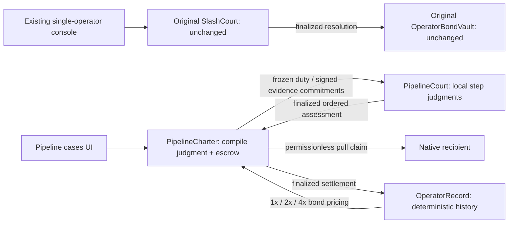

# Pipeline Court v2 — architecture and custody

Updated 2026-11-12. Architecture is verified separately from live receipts in
the dated deployment manifest and PIPELINE-LIVE.md.

Pipeline Court is built on the Liability Cascade prototype, reviewed and deployed
on 2026-10-20. The port preserves the complete ordered assessment comparison and
the earliest-violation/earlier-uncertainty scan. It adds a separate charter
compilation judgment, native GEN escrow, filing-bond allocation, pull claims,
and finalized operator history. The private prototype's synthetic accounting is
not presented as native custody proof.

## Authority and consensus

The charter supplies 2–5 distinct operators and local duties. Validators compare
an exact ordered set of boolean checkability, disjointness, and observable-output
checks. Compiled duties retain the submitted text rather than model paraphrases.
A self message emitted at finality opens funding or marks rejection. No deposit
is accepted into an unfrozen charter. Job hashes include deployment, job ID,
charter, steps, bond amounts, filing bond, and all deadlines.

Each operator freezes its own input/output URL and digest. Evidence admission
allows only raw.githubusercontent.com URLs with an exact lowercase 40-hex commit.
The claimant opens a dispute against these operator-authored commitments; it
cannot replace them. A pinned URL establishes byte immutability, not the truth
of the log or real-world execution. Synthetic fixtures must remain labelled.

The Court independently fetches both sides of every step, retains the exact
availability/digest observations, and requests one bounded local verdict and
one verbatim quote. Quotes must occur in the independently fetched text. The
validator compares the entire ordered envelope, including quotes, against its
own work. Earlier uncertainty blocks a later violation. Later faithful
propagation does not create an invented filtering obligation.

One deliberate difference from the prototype: missing records and mismatched
digests become UNCLEAR, not automatic misconduct. This follows this milestone's
explicit rule that unavailable evidence must not create default liability.

## Finality and money

Court assessment remains provisional until a self finality callback. Anyone may
then request Charter settlement. The claimant receives only the earliest
violator's bond plus its own filing bond; other bonds are credited back. When
all steps are faithful, the filing bond is distributed across the operators
with cumulative integer division to conserve dust. Earlier uncertainty waits
until the refund deadline and then refunds deposits and filing value.

The Charter marks credits spendable only after settlement finality. A claim
reserves the entire recipient credit before emitting a native transfer. Anyone
may trigger a claim for its fixed recipient. verify_claim independently checks
the finalized parent, exact claim calldata, attempt, sender, child linkage,
recipient, amount, and positive value_credited. Verification itself finalizes
before accounting marks paid. Failed transfers may retry with a new attempt;
unknown transfers stay reserved. Rejected payable business requests produce
sender-owned refundable credit rather than reverting after StudioNet credits
the value. Rejected-credit attempts remain monotonic to prevent receipt replay.

## Fund-lock audit

| Holding state | Permissionless exit | Check still required |
| --- | --- | --- |
| Incomplete funding | settle at funding_deadline | Live native refund |
| Active job with no incident | settle at deadline | Live native refund |
| Disputed job with unavailable/unclear evidence | settle at deadline | Distributed uncertainty case |
| Court callback missed | Charter deadline refunds | Live timeout demonstration |
| Compile/settlement/claim-verification callback missed | recover_finality with finalized source receipt | Additional adversarial tests + live recovery |
| Final settlement credit | claim by any caller for fixed recipient | Native child credit proof |
| Invalid payable business request | claim using __rejected__ | Live rejected-credit claim |
| Transfer pending/credit unknown | permissionless verify_claim | Protocol receipt availability is required; safe retry must never assume failure |

This is a focused release review, not an external custody audit. Tests cover
174 new direct cases plus 43 original cases (217 total). The applicable
predecessor adversarial matrix is ported, with additional charter and custody
coverage; the raw predecessor test count is not claimed. Claim reservation,
recovery, native receipt identities and all stored consensus leaf mutations
have direct regression coverage. StudioNet native transfer proof remains a
separate receipt-based gate, recorded in the release manifest.

## Operator records

Only finalized Charter settlements can be synchronized. A selected liable
operator gains one violation; faithful step counts use the stored assessment;
voids do not manufacture misconduct. Sync is once per job. Charter compilation
refuses stale pricing when that operator's latest finalized job has not been
recorded. Multipliers are frozen when the new charter compiles.

## Release gates

Contract lint, direct/frontend tests, TypeScript, production webpack build and
original deployment readback passed. Desktop/mobile mocked workflow checks
passed against `next start`. Three new contracts are deployed; actual receipts,
source identity, native credit and ACCEPTED-window proof are recorded in the
dated release manifest. Final public production checks are recorded separately
from local mocks. See PIPELINE-HANDOFF.md and PIPELINE-LIVE.md.
