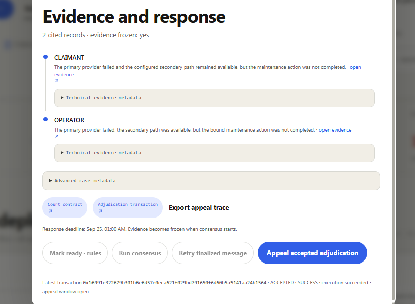

# Steward response draft

## Current state (verified 2026-09-21)

**Current deployment (GenLayer Studio Network, chain 61999):**

- Court `0x56e26ec256afe37199fe9845e039f5DEdd9e955a`, Vault
  `0xb1fD046CA7D92b84b16f66bdE676f442cA599Aa7`.
- Contract source: `gen_getContractCode` for both addresses returned source
  byte-identical to `contracts/slash_court.py` and
  `contracts/operator_bond_vault.py` in the current repository (unchanged
  since `cdaba78`).
- Production console: [slash-court.vercel.app](https://slash-court.vercel.app)
  resolves to `dpl_9hjHjBeGb6PADjmNvDAotN9ynMGE` (READY). It was built from a
  clean `git archive` of
  [`f55f083`](https://github.com/JWattjr/Slash-court/commit/f55f08379c436787f251fe1d11b998240bb48337),
  and the page root reports
  `data-source-revision="f55f08379c436787f251fe1d11b998240bb48337"`.
  Frontend and contract code are identical to `068ac47`; later commits change
  only documentation and evidence.

### ACCEPTED-window appeal proof (case-8)

The production console showed adjudication
[`0x16991e322679b301b6e6d57e0eca621f029bd791650f6d60b5a5141aa24b1564`](https://explorer-studio.genlayer.com/tx/0x16991e322679b301b6e6d57e0eca621f029bd791650f6d60b5a5141aa24b1564)
as `ACCEPTED · SUCCESS · appeal window open`, with **Appeal accepted
adjudication** enabled.

| Event (2026-09-21, UTC) | Time |
| --- | --- |
| Adjudication created (`adjudicate_case("case-8")`, via console + MetaMask) | 21:54:45.3 |
| ACCEPTED | 21:55:00.96 |
| Screenshot file written | 21:55:13.24 |
| Finality-triggered Vault messages created | 21:55:34.05 |

The screenshot is SHA-256 `e6eea793…b7dff8`, taken 12.3 s after ACCEPTED and
20.8 s before finality. The button renders only for an ACCEPTED, eligible
adjudication in the case's retained history, and its `data-appeal-target` is
that entry's hash. Case-8 has one adjudication, the hash shown on screen. The
DOM attribute itself was not captured. The appeal was **not** clicked: the
receipt shows `appealed: false` and a single consensus round.

### Steward requirement proof table

| Requirement | Evidence | Status |
| --- | --- | --- |
| Bind every adjudication to the canonical duty, trigger, deadlines, expected action, and alleged rules | `_require_adjudication_binding` re-reads the Vault commitment before consensus and rejects any mismatch with the case's canonical JSON. Case-8's `get_case` shows duty `Synthetic keeper duty for steward appeal-window proof v3`, trigger `scheduled-steward-appeal-proof-v3`, deadlines 2026-09-24/25, action `maintenance-action-steward-proof-v3`, digest `sha256:3acb6ad4…1511`, and alleged R1/R3. The Vault payload repeats the same digest and rules. | Satisfied (live) |
| Slash outcomes cite fetched evidence with party and rule metadata | `_canonicalize_adjudication_result` rebuilds each citation from fetched records. The validator compares `_consensus_bound_result`, which includes the evidence ID, party, type, domain, hash, and rules. Case-8 cites `claimant-steward-appeal-v3` (CLAIMANT, R1/R3) and `operator-steward-appeal-v3` (OPERATOR, R3) in both Court and Vault. | Satisfied (live) |
| Deterministic penalty, only after finality, applied once | 0.1 GEN × 5000 bps = 0.05 GEN, split 0.04 GEN beneficiary and 0.01 GEN safety pool. `apply_resolution` ([`0x54eea353…eb187`](https://explorer-studio.genlayer.com/tx/0x54eea353b9bf788e1add183b54392ac2c88863cc6c5a5979365fb81508eeb187)) is emitted `on="finalized"` and was created 33 s after ACCEPTED. The Court has one `adjudicate_case`, one `apply_resolution`, and no retry for case-8. | Satisfied (live) |
| Console retains an ACCEPTED adjudication and exposes an appeal control before finality | Case-8 screenshot above, inside the ACCEPTED window, on the verified `f55f083` production build. The appeal was not submitted. | Satisfied (live) |

Every adjudication rebinds the Vault's canonical duty, trigger, duty/dispute
deadlines, expected action, parties, exposure, rulebook version, commitment
digest, and alleged rule IDs. The hardened consensus path canonicalizes each
fetched evidence citation and binds evidence ID, party, type, source domain,
content hash, and relevant rules. The fresh live case proves this with
`negligence-rc-01`, `CLAIMANT`, `slash-court.vercel.app`, the recorded SHA-256
hash, and R1/R3 metadata in both Court and Vault records.

The first authorized synthetic case finalized as `NEGLIGENT_FAILURE` /
`PARTIAL_SLASH`. The adjudication is
`0x003e75129584a8a044f86a50b79f1f34cc8e48de5c5ad91daeb52c47eed550c2`; the
finality acknowledgement is
`0xde154a09b3a4648dfee7fecc2f3c3a3dd1af261d804ed0bd339557ef130f7899`; and the
Vault application is
`0xb317a13f944b9165d5b851cd889050ea06bf39ed9fd0233513de7d95403c915c`. All
are FINALIZED. The Vault applied one deterministic 0.5 GEN penalty: 0.4 GEN
beneficiary compensation and 0.1 GEN safety pool, leaving 1.5 GEN available
and zero locked exposure. No penalty was applied before finality and no
duplicate application was submitted.

A second authorized synthetic case provides the outage contrast. Case-2,
`demo-appeal-window-outage-rc-20260913`, finalized as `EXTERNAL_OUTAGE` /
`NO_SLASH` under supported exemption `R4`, with alleged rules R1/R4 and no
violated rules. Its canonical duty is
`scheduled-rc-appeal-window` / `outage-recovery-action-rc`, with a 0.5 GEN
locked exposure. The adjudication is
`0x27350a2b64cd0dce7c505678787c9e6d7085b064446e224ea03d591b8fa06d3b`; the
finality acknowledgement is
`0x75908f2e5f104fdb5e0cb6c36f876ba237f4c516d55cb74cccd7ebf4a5f58ebf`; and the
finalized Vault application is
`0x42493f6116efb397dd78202174df0ada3d2a7861e046492c4eda06f69cde7645`. The
application payload preserved both claimant and operator citations with their
party, type, domain, hash, and R1/R4 metadata. The Vault applied zero penalty,
zero award, and zero safety-pool allocation; aggregate accounting remains 1.5
GEN available and zero locked exposure. A subsequent direct Court read was
transiently unavailable, so the evidence record relies on the finalized
receipts and independent Vault read for this case.

A final bounded authorized synthetic run was then opened specifically to test
the ACCEPTED-window workflow. Case-3,
`demo-appeal-window-negligence-rc-20260914`, is bound to the canonical duty
`scheduled-rc-final-appeal-window` / `maintenance-action-final-rc`, exposure
`0.5 GEN`, dispute deadline `2026-09-16T02:00:00Z`, and alleged rules R1/R3.
The fetched claimant and operator citations preserve IDs
`negligence-appeal-rc-01` and `operator-appeal-rc-01`, their parties, the
`slash-court.vercel.app` domain, the SHA-256 content hash, and rule metadata.
The adjudication finalized at
`0xd315d43889d5c0be676490504ce88c604fe72448058d948f8ef832a5e8e04203` as
`NEGLIGENT_FAILURE` / `PARTIAL_SLASH`. The production console shows the Vault
application as **Applied once**, with `0.2 GEN` beneficiary compensation and
`0.05 GEN` safety-pool allocation. The aggregate console read after this case
shows `1.25 GEN` available, `0 GEN` locked exposure, and `0.75 GEN` penalties.
The public UI does not expose the child application hash, so no child hash is
invented or presented.

An additional authorized capture attempt created case-4,
`demo-appeal-capture-negligence-20260914`, bound to duty
`scheduled-accepted-capture` / `maintenance-action-accepted-capture`, exposure
`0.25 GEN`, and alleged rules R1/R3. Both fetched citations preserve their
claimant/operator party, evidence type, domain, hash, and rule metadata. It
finalized at
`0x492d5254686ae2155465ac180b794f889ec5b17570ef1c4192df028b69fb1ede`
as `NEGLIGENT_FAILURE` / `PARTIAL_SLASH`. The Court read reports
`APPLIED_FINALIZED`; the console shows **Applied once**, `0.1 GEN` beneficiary
compensation, and `0.025 GEN` safety-pool allocation. The direct Vault read
after case-4 shows `1.125 GEN` available, zero locked exposure, `0.875 GEN`
total penalties, and `0.175 GEN` in the safety pool across four applications.
No child application hash is exposed, so none is claimed.

The final bounded synthetic capture attempt created case-5,
`demo-final-accepted-window-20260914`, bound to
`scheduled-final-accepted-window` / `maintenance-action-final-accepted-window`,
with `0.25 GEN` exposure and alleged rules R1/R3. The finalized adjudication
is
`0xf9a3bca4fd27533252a28cefed0f82aa1ae556b9c7bfcf509ce67b7129e906d2`,
`NEGLIGENT_FAILURE` / `PARTIAL_SLASH`, with a deterministic `0.125 GEN`
penalty. The finality acknowledgement is
`0x5531989db9a2d133a970e5f94d2f5046fab37471c3f5326bffd10eba9e863d3d`, and
the finality-triggered Vault application is
`0x23d99e6c3848f6bbd0d2e741100650b5c66f449265e32903e240dd453573c21f`.
Both child receipts are FINALIZED. The Vault read preserves the canonical
commitment digest, R1/R3, claimant citation `negligence-final-accepted-01`,
operator citation `operator-final-accepted-01`, their party/type/domain/hash
metadata, and applies `0.1 GEN` to the beneficiary plus `0.025 GEN` to the
safety pool exactly once. The operator read shows `1.0 GEN` available and zero
locked exposure.

Two more bounded synthetic runs followed on 2026-09-14. Both are recorded from
chain data read on 2026-09-19:

- **Case-6**, `demo-accepted-window-final-20260914-v4`: adjudication
  [`0xffbcda1e…536e9ce4`](https://explorer-studio.genlayer.com/tx/0xffbcda1eebf887aa06621245dffb511370c334d2749953b7d0eceb39536e9ce4),
  Vault application
  [`0xe90f1f13…d175147a`](https://explorer-studio.genlayer.com/tx/0xe90f1f1376d25b55ae332a1808dbb6dda8c3e285062855fc48f0d872d175147a).
  Result: `NEGLIGENT_FAILURE`, 0.05 GEN penalty, applied once. There is no
  ACCEPTED-window capture.
- **Case-7**, `demo-steward-appeal-proof-v2-20260914`: duty `Synthetic keeper
  duty for steward appeal-window proof v2`, trigger
  `scheduled-steward-appeal-proof-v2`, duty deadline `2026-09-20T00:00:00Z`,
  dispute deadline `2026-09-21T00:00:00Z`, expected action
  `maintenance-action-steward-proof-v2`, exposure 0.1 GEN, alleged R1/R3. The
  adjudication is
  [`0x093fcb32c4c2d4a751ad0cdff969f89ac3d85974ff34d9971071d046d170fcdd`](https://explorer-studio.genlayer.com/tx/0x093fcb32c4c2d4a751ad0cdff969f89ac3d85974ff34d9971071d046d170fcdd).
  Its calldata is `adjudicate_case("case-7")`, it had 5 validators with
  `MAJORITY_AGREE`, and it was never appealed. Timeline: created
  20:29:16Z, **ACCEPTED 20:29:44Z**, finality-triggered children created
  20:30:15Z, all on 2026-09-14.
  - Finality acknowledgement:
    [`0x03cebc88…2ca0166d`](https://explorer-studio.genlayer.com/tx/0x03cebc88875814bb3b487eaba3890b603e5fa16507b7536bba16bc3b2ca0166d)
  - Vault application:
    [`0xc9237058…c83a5a78`](https://explorer-studio.genlayer.com/tx/0xc9237058af58cb64b03fb0393993e82b1e44db579d6048e1d4efb700c83a5a78)

  Both are FINALIZED. Result: `NEGLIGENT_FAILURE` / `PARTIAL_SLASH`, 0.05 GEN
  penalty, 0.04 GEN to the beneficiary and 0.01 GEN to the safety pool,
  applied once. The Vault commitment is `RESOLVED`.

On StudioNet, the gap between ACCEPTED and finality was about **30 seconds**.
The session that submitted case-7 saw no hash and no enabled appeal control
inside that window, and no ACCEPTED-window screenshot exists. The 2026-09-19
pass found case-7 already FINALIZED. It does not present any finalized view as
ACCEPTED proof.

After all seven cases, aggregate Vault reads show 0.9 GEN available, zero
locked exposure, 1.1 GEN total penalties, and 0.22 GEN in the safety pool. The
operator has 7 resolved commitments.

The console retains the exact adjudication hash after ACCEPTED and releases
its busy state while finality continues in the background. Across five bounded
runs, the eligibility/control capture was not completed before finality: the
earlier runs are retained as historical attempts, and case-5's next usable
browser state was already FINALIZED. The appeal control was not captured
enabled. No appeal was clicked or submitted. Historical predecessor cases
remain clearly labelled synthetic and historical; they are not claimed as
cases of the fresh deployment.

Checks re-run at `068ac47` on 2026-09-19: 16 frontend workflow tests, 43
direct contract tests, typecheck/lint (`tsc --noEmit`), production build, and
`git diff --check` passed. GenVM lint and schema checks were not re-run because
`genvm-lint` is not installed here; their earlier passes are historical.
These checks are local. The live proof comes from the RPC and explorer reads
above. Earlier record, kept for history: 14 frontend workflow tests, 43 direct
contract tests, typecheck, lint, production build, `git diff --check`, GenVM
lint, and schema checks passed. The
rendered frontend regression covers immediate busy-state release after
ACCEPTED, delayed eligibility recovery, exact hash targeting, unrelated
transactions, and terminal finality. The production deployment is READY and
its source marker was verified in the browser. No integration suite or
transaction-producing test was run as a test suite; the separately authorized
case-5 live workflow is recorded above. The optional pyright check was
unavailable because the binary is not installed.

**Resubmit-ready: YES.** The hardened Court and Vault source is live and
byte-identical to the repository. Production runs the verified `f55f083` build.
Case-8 shows canonical binding, party- and rule-tagged fetched-evidence
citations, a deterministic finality-gated penalty applied once, and a live
screenshot of the enabled appeal control for the retained ACCEPTED adjudication
inside the StudioNet window. No appeal was clicked or submitted, and no Portal
submission was made.
